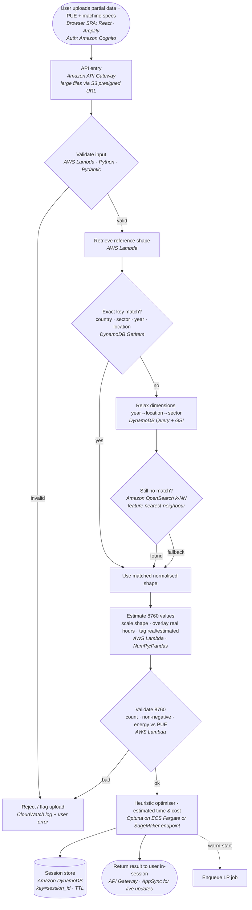
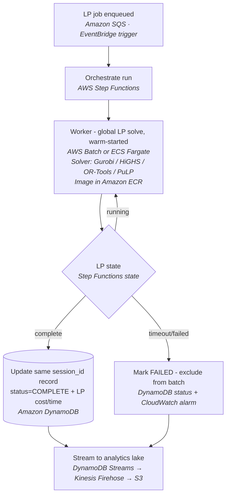
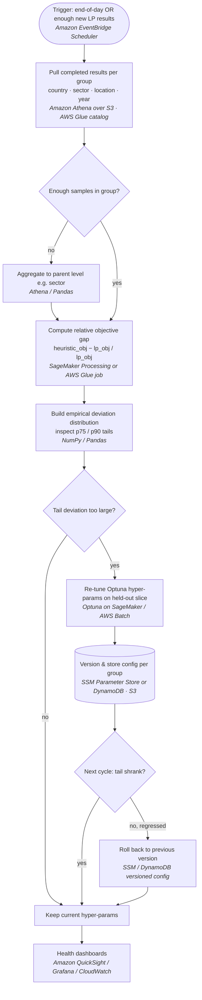
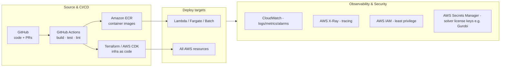

# Demand-Profile Optimisation Pipeline — Flowchart (with services/tooling)

Mermaid diagrams for the pipeline, with concrete AWS services and other tools named inside each cell. Four views: live session path, background LP path, offline calibration loop, and a combined view — plus a tooling summary and a stage→service table.

> Service choices are the sensible default stack, not the only option. Swap equivalents where your team already has expertise (e.g. GCP/Azure, or self-hosted).

---

## 1. Live session path (synchronous, fast)

---

## 2. Background LP path (asynchronous, exact)

---

## 3. Offline calibration loop (batch, self-tuning)

---

## 4. Combined end-to-end view

```mermaid
flowchart LR
    subgraph LIVE["Live session - synchronous"]
        A(["Upload<br/><i>React · Cognito</i>"]) --> B["Validate<br/><i>API Gateway · Lambda</i>"]
        B --> C["Retrieve shape<br/><i>DynamoDB · OpenSearch k-NN</i>"]
        C --> D["Estimate 8760<br/><i>Lambda · NumPy</i>"]
        D --> E["Heuristic / Optuna<br/><i>ECS Fargate / SageMaker</i>"]
        E --> F(["Return to user<br/><i>API Gateway · AppSync</i>"])
    end

    subgraph STOREL["Storage - hot path"]
        G[("DynamoDB<br/>session_id · TTL")]
    end

    subgraph BG["Background - asynchronous"]
        H["Enqueue LP<br/><i>SQS · Step Functions</i>"] --> I["Worker LP solve<br/><i>AWS Batch/Fargate · Gurobi/HiGHS · ECR</i>"]
        I --> J[("Update session record<br/><i>DynamoDB</i>")]
    end

    subgraph ANALYTICS["Analytics - cold path"]
        K["Data lake<br/><i>DynamoDB Streams · Firehose · S3 · Glue · Athena</i>"]
    end

    subgraph CAL["Offline calibration loop"]
        L["Gap distribution p75/p90<br/><i>SageMaker Processing / Glue</i>"]
        L --> M{"Tail too large?"}
        M -- yes --> N["Re-tune Optuna<br/><i>Optuna · SageMaker</i>"]
        N --> O[("Versioned hyper-params<br/><i>SSM Parameter Store</i>")]
        M -- no --> P["Keep config"]
        O -.-> E
    end

    E --> G
    E -. warm-start .-> H
    G --> K
    J --> K
    K --> L
```

---

## 5. Cross-cutting tooling (not in the flow, but everywhere)

---

## 6. Stage → service quick reference

| Stage | Primary service(s) | Alternatives / notes |
|---|---|---|
| Frontend / upload | React + AWS Amplify, Amazon Cognito | Any SPA host; Auth0 instead of Cognito |
| API entry | Amazon API Gateway (+ AppSync for live updates) | ALB + ECS if containerised API |
| Input & 8760 validation | AWS Lambda (Python, Pydantic) | Fargate if long-running |
| Profile catalogue (8760 arrays) | Amazon S3 (Parquet) + metadata in DynamoDB | Dynamo-only if always keyed lookup |
| Exact / relaxed retrieval | DynamoDB GetItem + GSI Query | — |
| Similarity fallback | Amazon OpenSearch (k-NN) | pgvector on RDS; Pinecone |
| Heuristic optimiser | Optuna on ECS Fargate or SageMaker endpoint | Lambda if fast enough |
| Session results (hot) | Amazon DynamoDB (TTL) | — |
| LP queue & orchestration | Amazon SQS + AWS Step Functions + EventBridge | — |
| LP solver compute | AWS Batch / ECS Fargate | Gurobi / HiGHS / OR-Tools / CBC / PuLP |
| Solver container registry | Amazon ECR | Docker Hub (private) |
| Analytics landing | DynamoDB Streams → Kinesis Firehose → S3 | Direct S3 writes |
| Query / grouping (cold) | Amazon Athena + AWS Glue catalog | Redshift / EMR |
| Batch gap computation | SageMaker Processing / AWS Glue job | EMR Spark at scale |
| Re-tuning | Optuna on SageMaker / AWS Batch | — |
| Versioned hyper-params | AWS SSM Parameter Store / DynamoDB + S3 | — |
| Scheduling | Amazon EventBridge Scheduler | cron on a worker |
| Dashboards | Amazon QuickSight / Grafana / CloudWatch | — |
| Source & CI/CD | GitHub + GitHub Actions | GitLab CI; CodePipeline |
| Infra as code | Terraform / AWS CDK | CloudFormation / Pulumi |
| Secrets (e.g. Gurobi license) | AWS Secrets Manager | SSM SecureString |
| Observability | CloudWatch + AWS X-Ray | Datadog |
| Access control | AWS IAM (least privilege) | — |

---

### Legend

- **Rounded nodes** = start/end / user-facing events.
- **Rectangles** = processing steps (service named in italics).
- **Diamonds** = decisions / branches.
- **Cylinders** `[( )]` = data stores.
- **Dotted arrows** = asynchronous or feedback links (LP warm-start, hyper-param updates flowing back into the heuristic).
